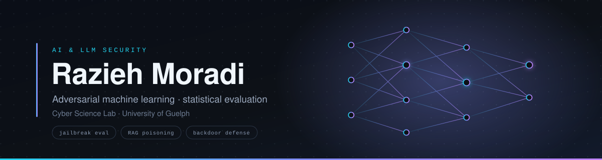

  

  
  
  
  

---

I study how large language models fail, and how to measure that failure honestly.

I am a researcher at the Cyber Science Lab at the University of Guelph, where I have worked since September 2025 with Dr. Fattane Zarrinkalam, Dr. Ali Dehghantanha, and Dr. Havva Alizadeh Noughabi. My work sits where probability theory, adversarial machine learning, and security meet.

My route here was not the usual one. I hold two master's degrees, one in Systems and Technology from McMaster University and one in Industrial Engineering by thesis, both of them quantitative engineering degrees built on statistics, optimization, and operations research. Before research I spent eight years coordinating enterprise systems delivery for the National Iranian Oil Company, a multi year ERP implementation with Arthur D. Little as implementation partner. That work left me with a systems engineer's instinct for how complex systems actually break once real people and real incentives are attached to them. I now point that instinct at language models.

 

## Multi turn jailbreak attacks and defense evaluation

A defense that reports success has told you almost nothing. It has told you a flag flipped. It has not told you what the attacker walked away with.

So I built a local red teaming pipeline that runs **adaptive** multi turn attacks, not static prompt sets, against six published defenses across four open model families, and then measures what each defense actually prevented.

Every one of the 36,000 defended rounds is scored twice, once for the harm present right now and once for the forward looking residual risk the conversation has set up. A benign over refusal gate runs alongside, so a defense cannot win by refusing everything it sees.

Defenses are then compared with paired bootstrap confidence intervals and sign flip permutation tests under Holm correction, and the whole corpus is checked by a blinded expert audit. The annotation console for multi expert scoring is a React application I wrote for the project.

**Stack** · garak · PyRIT · llama.cpp · PyTorch · React

 

## Other research threads

<table border="0">
<tr>
<td width="50%" valign="top">

### RAG security and knowledge poisoning

The internal representations of cross encoder rerankers carry signals that separate poisoned passages from clean ones. I used those signals to detect knowledge poisoning attacks on retrieval augmented generation pipelines, and built poisoned retrieval corpora on HotpotQA, MS MARCO, and Natural Questions for robustness testing.

Published at Canadian AI 2026, oral presentation.

</td>
<td width="50%" valign="top">

### Topological backdoor detection

A controlled study of whether persistent homology features of layer activations detect backdoor inputs better than plain distance statistics, with class conditional controls and paired comparisons of the same image with and without the trigger.

| Backdoored ResNet18, CIFAR10 | |
|---|---|
| Clean accuracy | ~94.5% |
| Attack success | 99.4% |

</td>
</tr>
<tr>
<td width="50%" valign="top">

### Escalation forecasting

Trajectory level safety risk forecasting on the scored multi turn corpus, so that a dangerous conversation is flagged while it is still escalating rather than after harm occurs. A first step toward an adaptive defense controller.

</td>
<td width="50%" valign="top">

### Self healing knowledge constrained AI

A three phase research program

 

**Phase I** · Knowledge graph and code behaviour guided fault localization, labelling prompts as malicious or benign through consistency checks and execution trace analysis.

**Phase II** · A reinforcement learning defense that enforces knowledge graph constrained policies and synthesizes safe patches while preserving utility and factuality.

**Phase III** · Teacher student distillation into lightweight models for resource constrained deployment.

</td>
</tr>
</table>

 

## Mathematical foundations

I came to machine learning through operations research, so the mathematics came first. It is the part of my training I lean on hardest, because security research is full of results that sound strong until you ask what was actually estimated and how much of it is noise.

<table border="0">
<tr>
<td width="50%" valign="top">

**Probability and statistics**

Statistical inference, hypothesis testing under multiplicity, and resampling. In practice: paired bootstrap confidence intervals, sign flip permutation tests, Holm correction across families of comparisons, and inter rater agreement on human scored corpora.

Graduate coursework in Statistical Methods, Advanced Statistical Methods, and Multivariate Statistical Methods for Big Data.

</td>
<td width="50%" valign="top">

**Linear algebra**

Matrix decompositions, projections, eigenstructure, and the geometry of high dimensional embedding spaces.

The working language of my representation level work, where the detection signal comes from how activations sit relative to one another rather than from anything the model says.

</td>
</tr>
<tr>
<td width="50%" valign="top">

**Game theory**

Best responses, equilibrium, and the uncomfortable fact that a defense measured against a fixed attacker tells you almost nothing about what happens once the attacker adapts.

That reasoning is why I evaluate with adaptive multi turn attacks rather than static prompt sets.

</td>
<td width="50%" valign="top">

**Operations research**

Linear and integer programming, multi objective optimization, queuing theory, and multi criteria decision methods.

My Industrial Engineering thesis built a multi objective programming model using the fuzzy analytic network process for supplier and carrier selection.

</td>
</tr>
</table>

 

## Publications

**Defending RAG Against Knowledge Poisoning Using Cross-Encoder Activation Signals**
 R. Moradi, H. Alizadeh Noughabi, F. Zarrinkalam, A. Dehghantanha
 Canadian AI 2026, 39th Canadian Conference on Artificial Intelligence · oral presentation · PMLR vol. 318
 <a href="https://proceedings.mlr.press/v318/moradi26a.html">Read the paper</a>

Further manuscripts in progress on multi turn jailbreak evaluation and topological backdoor detection.

 

## Service

| | |
|---|---|
| **Program Committee** | AutonomousCyber 2026 workshop at ESORICS 2026 |
| **Reviewer** | ICLR 2027 · ECIR 2027 · IEEE Internet of Things Journal 2026 · CEEA-ACEG 2025 |
| **Organizer** | SECURE-AGRO workshop, PST 2026, Ottawa |
| **Proposal author** | IEEE CCECE 2027 workshop, accepted and on the program |

 

## Toolbox

  
  
  
  
  
  
  

  
  
  
  
  
  

  
  
  
  

  
  
  
  

<b>The full list</b>

 

| Area | Tools and methods |
|---|---|
| Large language models | fine tuning, LoRA, 4 bit quantization, RAG pipelines, knowledge graphs, reinforcement learning, LLM as judge evaluation |
| Natural language processing | spaCy, NLTK, Gensim, tokenizers |
| Computer vision | OpenCV, torchvision, PIL, Albumentations, CNN classification, semantic segmentation, object detection, transformer based vision models |
| Mathematics | probability, statistical inference, stochastic modelling, linear algebra and matrix decompositions, game theory, linear and integer programming, multi objective and multi criteria optimization, queuing theory, fuzzy analytic network process |
| Enterprise systems | SAP, full cycle ERP implementation, fit gap analysis, user acceptance testing, business intelligence reporting |

 

## Selected engineering work

<b>LunaNet-DX</b> · electric vehicle charging load forecasting, Burlington Hydro Inc.

 

Identified electric vehicle ownership across a dataset of more than 68,000 households, then designed a custom attention based architecture for forecasting charging loads, with interactive dashboards supporting utility infrastructure planning.

<b>Pneumonia detection</b> · teacher student knowledge distillation

 

A lightweight student CNN detecting pneumonia from chest radiographs, distilled from a larger teacher model, which outperformed a fine tuned ResNet-50 on both recall and AUC-ROC.

| Model | Recall | AUC-ROC |
|---|---|---|
| Student CNN, distilled | **92.56%** | **90.36** |

<b>Fine tuning large language models</b> · under GPU constraints

 

Fine tuned GPT-2 XL, DeepSeek R1-Qwen, LLaMA-3, Mistral-7B, and Gemma-3-4B on a dialogue corpus using LoRA and 4 bit quantization, then evaluated the results with an LLM as judge protocol.

<b>Hybrid RAG virtual teaching assistant</b> · McMaster University

 

A retrieval augmented generation and knowledge graph system for personalized learning and question answering in engineering education.

<b>IoT medication reminder and dispensing device</b> · McMaster University

 

A working hardware prototype that reminds users to take medication and dispenses it on schedule. Donated to McMaster's medical school, where it remains in use.

 

## Education

| Degree | Institution | Years |
|---|---|---|
| **MEng** Systems Technology, Smart Systems and AI | McMaster University | 2024 to 2026 |
| **MSc** Industrial Engineering 
| **BSc** Industrial Engineering

Graduate cumulative average of 11.57 on the 12 point scale at McMaster. Master's thesis: a multi objective programming model using the fuzzy analytic network process to optimize supplier and carrier selection in order allocation.

Teaching assistant in Statistical Methods and Integer Variable Programming, and in Advanced Statistical Methods, Computer Programming, and Multivariate Statistical Methods, Large scale software architectures. I have mentored junior colleagues throughout my career, and informally supported international women students in McMaster's engineering program through the Machine Learning and Cloud Computing courses.

  
  

---

  
  

  Open to research collaboration on LLM security, adversarial evaluation, and trustworthy AI.

